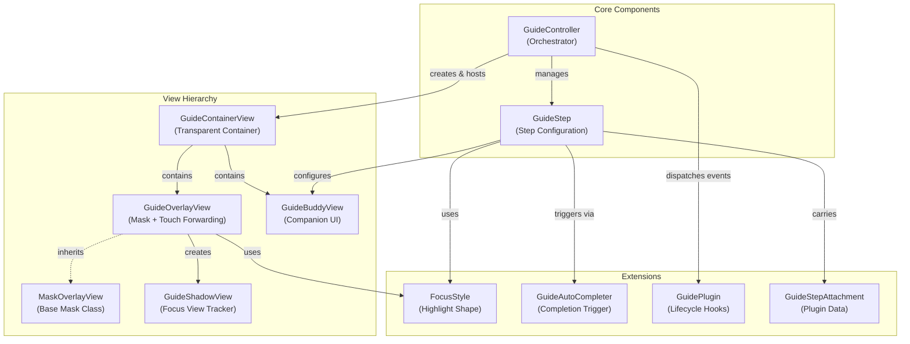

# PolarisGuideKit

[中文说明](README.md)

A lightweight UIKit based guide/onboarding ("coach marks") component for highlighting UI elements with a cut-out mask, optional companion views, and step-based orchestration.


## Features

- Highlight a single focus view with an animated mask transition (`GuideOverlayView`)
- Auto-tracking of focus view position changes, adapting to screen rotation, animations, and more
- Step-based guide orchestration (`GuideController` + `GuideStep`)
- Companion overlay UI via subclassing (`GuideBuddyView`)
- Customized auto-completion triggers (`GuideAutoCompleter`, `ControlEventCompleter`, `GestureRecognizerCompleter`)
- Pluggable step extensions via plugins and attachments (e.g., audio playback, analytics tracking, guide-shown flag persistence)
- Minimal intrusion, preserving your existing business logic

## Requirements

- iOS 12+
- Swift 5.0+
- UIKit

Perform all UIKit-related creation, configuration, presentation, step changes, dismissal, and refresh operations on the main thread. `focusViewProvider` is also called during these operations.

## Installation

### Swift Package Manager

1. In Xcode: **File → Add Packages…**
2. Paste repo URL: `https://github.com/noodles1024/PolarisGuideKit`
3. Select **PolarisGuideKit**

### CocoaPods

Add to your Podfile:

```ruby
pod 'PolarisGuideKit'
```

Then in your code:

```swift
import PolarisGuideKit
```

## Quick Start

```swift
import UIKit
import PolarisGuideKit

final class MyViewController: UIViewController {
    private var guide: GuideController?

    override func viewDidLoad() {
        super.viewDidLoad()
        // Assume myButton has already been added to view.

        let step1 = GuideStep()
        step1.focusView = myButton
        step1.buddyView = MyBuddyView()
        step1.forwardsTouchEventsToFocusView = true
        step1.completer = ControlEventCompleter(control: myButton, event: .touchUpInside)

        let controller = GuideController(hostView: view, steps: [step1])
        controller.onDismiss = { _, context in
            print("Guide dismissed. reason=\(context.reason)")
        }

        // Neither view nor myButton needs a window during initialization.
        guide = controller
    }

    override func viewDidAppear(_ animated: Bool) {
        super.viewDidAppear(animated)
        guide?.show()
    }
}
```

## Custom Buddy View

Subclass `GuideBuddyView`, build your UI, and call `requestNext()` / `requestSkip()` when appropriate.

```swift
import UIKit
import PolarisGuideKit

final class MyBuddyView: GuideBuddyView {
    private let nextButton = UIButton(type: .system)

    override init(frame: CGRect) {
        super.init(frame: frame)
        nextButton.setTitle("Next", for: .normal)
        nextButton.addTarget(self, action: #selector(onNext), for: .touchUpInside)
        addSubview(nextButton)
        // layout your subviews...
    }

    required init?(coder: NSCoder) { fatalError("init(coder:) has not been implemented") }

    override func updateLayout(referenceLayoutGuide layoutGuide: UILayoutGuide, focusView: UIView) {
        super.updateLayout(referenceLayoutGuide: layoutGuide, focusView: focusView)
        // Position your subviews relative to layoutGuide.
    }

    @objc private func onNext() {
        requestNext()
    }
}
```

## Custom Focus Style

Create a custom `FocusStyle` to control highlight shape.

```swift
import UIKit
import PolarisGuideKit

struct MyRoundedStyle: FocusStyle {
    func highlightPath(for focusView: UIView, frameInOverlay rect: CGRect) -> UIBezierPath? {
        UIBezierPath(roundedRect: rect.insetBy(dx: -8, dy: -8), cornerRadius: 12)
    }

    func buddyLayoutGuide(for focusView: UIView, shadowView: GuideShadowView) -> UILayoutGuide {
        shadowView.frameLayoutGuide
    }
}
```

## Dynamic FocusView (UITableView/UICollectionView)

When highlighting cells in `UITableView` or `UICollectionView`, cells may be reused after `reloadData`, causing the highlight to shift or disappear. Use `focusViewProvider` to dynamically obtain the correct cell:

```swift
let step = GuideStep()

// Use focusViewProvider for dynamic cell lookup
step.focusViewProvider = { [weak self] in
    guard let self else { return nil }
    var focusCell = self.tableView.cellForRow(at: targetIndexPath)
    if focusCell == nil {
        self.tableView.layoutIfNeeded()
        focusCell = self.tableView.cellForRow(at: targetIndexPath)
    }
    return focusCell
}

step.buddyView = MyBuddyView()
```

The closure is called whenever the highlight needs to be updated, ensuring it always targets the correct cell even after `reloadData`.

> **Note**: For static views that don't change, you can still use `step.focusView = myView` directly.

## Plugins & Attachments

PolarisGuideKit supports extending functionality through a plugin system. Plugins can execute custom logic at different stages of the guide flow, while attachments store per-step data.

### Built-in Plugin Example

**Audio Plugin**: Add background music or voice narration to steps

```swift
let step = GuideStep()
step.focusView = myButton

// Add audio attachment
if let url = Bundle.main.url(forResource: "guide_step_1", withExtension: "mp3") {
    step.addAttachment(GuideAudioAttachment(url: url, volume: 0.8))
}

// Enable audio plugin
let controller = GuideController(hostView: view, steps: [step], plugins: [AudioGuidePlugin()])
```

Buddy views can adopt plugin-specific protocols when needed:

```swift
final class MyBuddyView: GuideBuddyView, GuideAudioEventReceiving {
    func guideAudioDidStart() { /* update UI */ }
    func guideAudioDidStop(didPlayToEnd: Bool) { /* update UI */ }
    func guideAudioDidFail(_ error: Error) { /* update UI */ }
}
```

### Custom Plugins

You can create your own plugins by implementing the `GuidePlugin` protocol:

```swift
final class MyCustomPlugin: GuidePlugin {
    func handle(_ event: GuideEvent, context: GuideStepContext) {
        switch event {
        case .guideWillShow:
            // The guide is about to appear. Access its step through context.step.
            break
        case .stepDidHide:
            // The step was hidden; this does not necessarily mean the user completed it.
            break
        case .guideDidHide:
            // The guide was hidden.
            break
        default:
            break
        }
    }
}

// Use custom plugin
let controller = GuideController(hostView: view, steps: steps, plugins: [MyCustomPlugin()])
```

`stepDidShow` fires when the step is configured; `guideDidShow` fires after the overlay fade-in (if animated). Plugins that depend on fully visible UI should wait for `guideDidShow`.

## Architecture



## FAQ

### Touch forwarding doesn't work

- Ensure `step.forwardsTouchEventsToFocusView = true`
- Ensure the focus view is in the same window as the overlay

### Gesture recognizer doesn't fire

- Add the recognizer to `step.gestureRecognizerWhitelist`
- Gestures attached to table/collection views also need to be whitelisted

### Multi-window / multi-scene apps

Pass `view`, `navigationController.view`, or your app window according to the area the guide should cover. You can create and retain the controller in `viewDidLoad` with a nil `focusView.window`. Wait for that window only when you need to obtain it from the focus view to cover the entire window.

Host selection follows this order:

1. An explicit `hostView` takes priority. At `show()` time, the focus must belong to its view hierarchy. Both views can still be outside a window; scene activation is not required. `isShown()` reports attachment to the host, not whether the host is currently visible on screen.
2. When `hostView == nil`, the current focus view's `window` is used. If the focus is not attached to a window yet, `show()` returns `false` and can be retried. Once that window is available, no global key-window lookup is needed.
3. If a `focusViewProvider` is configured but currently returns `nil`, and no explicit host was supplied, `show()` returns `false`. Retry after the cell or target view is attached.
4. Automatic window lookup is used only when no focus is configured, such as a buddy-only step. A scene-based app must have exactly one `.foregroundActive` scene with the `.windowApplication` role and a suitable, unambiguous window in that scene. Noninteractive external-display scenes are excluded from this fallback. Supply an explicit host when multiple application scenes are active. On iOS 12, or in a legacy app with no connected scenes, the fallback uses a suitable window on the main screen while the app is active.

Initialization and `addStep(_:)` store step configuration without requiring the focus to be attached. `show()` and step transitions validate the host/focus hierarchy before creating constraints. An unavailable host or mismatched hierarchy returns `false` and can be retried later. The active-scene requirement applies only to the context-free automatic lookup in rule 4. Empty steps with neither a focus configuration nor a buddy view are still ignored.

Quick Start uses `viewDidAppear` as one possible presentation time. You can also call `show()` in `viewDidLoad` when the focus already belongs to the explicit host. If a navigation container has not attached the page yet, create the controller first and show it once that hierarchy is ready.

Each successful presentation stays bound to its original host. Changing the key window does not move the guide elsewhere or prevent `hide()` from cleaning up the original host. Disconnecting the bound scene automatically hides the guide and reports `.programmatic` through `onDismiss`. Screen mirroring uses the window containing your app UI; for a separate external-display interface, use that interface's focus view or an explicit host.

You can also use `showStep(at:)` or `showNextStep()` to select a starting step before calling `show()`. Preselection only records the step; it creates no cross-hierarchy constraints and sends no presentation events.

## Regression Tests

The standalone test project covers window selection, scene lifecycle, guide layout and interaction, and audio callbacks. It does not require the Demo's external dependencies. Run this command from the repository root:

```sh
xcodebuild -project Tests/PolarisGuideKitTests.xcodeproj \
  -scheme PolarisGuideKitTests \
  -destination 'platform=iOS Simulator,name=iPhone 17 Pro' test
```

Replace `iPhone 17 Pro` with a simulator installed on your machine. The library continues to support iOS 12+; the test host requires iOS 13+ to exercise Window Scene behavior.

## License

Licensed under the MIT License. See `LICENSE`.

## Support the Developer

If you find this project helpful, consider supporting my open source work ☕

### WeChat Reward (China Users)


<!-- Buy Me a Coffee (International Users) -->
<!-- [](https://www.buymeacoffee.com/noodles1024) -->

Or support in other ways:

- ⭐ Star the project on GitHub
- 🐛 [Create an Issue](https://github.com/noodles1024/PolarisGuideKit/issues) to report bugs or suggest features
- 🔀 [Submit a Pull Request](https://github.com/noodles1024/PolarisGuideKit/pulls) to contribute code
- 📢 Share this project on social media
