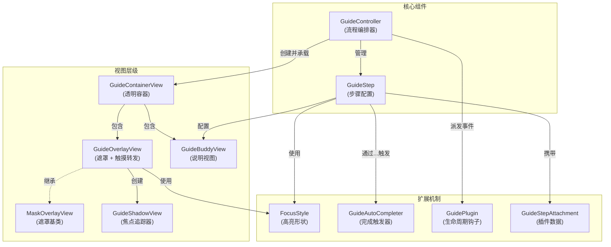

# PolarisGuideKit

[English](README.md)

一个轻量的基于 UIKit 的新手引导（coach marks）组件：通过遮罩挖孔高亮 UI 元素，并支持搭配说明视图（Buddy View）与按步骤编排的引导流程。


## 功能特性

- 单个 focusView 高亮（遮罩挖孔 + 可选过渡动画）：`GuideOverlayView`
- 高亮区域自动跟踪 focusView 位置变化，适配屏幕旋转、动画等场景
- 以步骤编排的新手引导流程：`GuideController` + `GuideStep`
- 通过继承实现任意说明/箭头/按钮视图：`GuideBuddyView`
- 可自定义的自动"完成条件"：`GuideAutoCompleter`、`ControlEventCompleter`、`GestureRecognizerCompleter`
- 可插拔的步骤扩展（插件 + 附件，例如音频播放、埋点事件上报、引导显示标志保存等）
- 侵入性小，能很好地保持原有业务逻辑

## 环境要求

- iOS 12+
- Swift 5.0+
- UIKit

所有涉及 UIKit 的创建、配置、展示、切步、隐藏和刷新操作都应在主线程执行，`focusViewProvider` 也会在这些操作中被调用。

## 安装

### Swift Package Manager

1. Xcode：**File → Add Packages…**
2. 填入仓库地址：`https://github.com/noodles1024/PolarisGuideKit`
3. 选择 **PolarisGuideKit**

### CocoaPods

在 Podfile 中添加：

```ruby
pod 'PolarisGuideKit'
```

然后在代码里：

```swift
import PolarisGuideKit
```

## 快速开始

```swift
import UIKit
import PolarisGuideKit

final class MyViewController: UIViewController {
    private var guide: GuideController?

    override func viewDidLoad() {
        super.viewDidLoad()
        // 此处假设 myButton 已添加到 view 中。

        let step1 = GuideStep()
        step1.focusView = myButton
        step1.buddyView = MyBuddyView()
        step1.forwardsTouchEventsToFocusView = true
        step1.completer = ControlEventCompleter(control: myButton, event: .touchUpInside)

        let controller = GuideController(hostView: view, steps: [step1])
        controller.onDismiss = { _, context in
            print("引导结束。原因=\(context.reason)")
        }

        // 创建时不要求 view 或 myButton 已进入 window。
        guide = controller
    }

    override func viewDidAppear(_ animated: Bool) {
        super.viewDidAppear(animated)
        guide?.show()
    }
}
```

## 自定义 Buddy View（说明/箭头/按钮等）

继承 `GuideBuddyView`，搭建 UI，在合适的时机调用 `requestNext()` / `requestSkip()`。

```swift
import UIKit
import PolarisGuideKit

final class MyBuddyView: GuideBuddyView {
    private let nextButton = UIButton(type: .system)

    override init(frame: CGRect) {
        super.init(frame: frame)
        nextButton.setTitle("下一步", for: .normal)
        nextButton.addTarget(self, action: #selector(onNext), for: .touchUpInside)
        addSubview(nextButton)
        // 自行布局...
    }

    required init?(coder: NSCoder) { fatalError("init(coder:) has not been implemented") }

    override func updateLayout(referenceLayoutGuide layoutGuide: UILayoutGuide, focusView: UIView) {
        super.updateLayout(referenceLayoutGuide: layoutGuide, focusView: focusView)
        // 根据 layoutGuide 相对定位你的子视图（避免遮挡高亮区域）
    }

    @objc private func onNext() {
        requestNext()
    }
}
```

## 自定义 FocusStyle（高亮形状）

实现 `FocusStyle`，控制挖孔形状（例如圆角等）。

```swift
import UIKit
import PolarisGuideKit

struct MyRoundedStyle: FocusStyle {
    func highlightPath(for focusView: UIView, frameInOverlay rect: CGRect) -> UIBezierPath? {
        UIBezierPath(roundedRect: rect.insetBy(dx: -8, dy: -8), cornerRadius: 12)
    }

    func buddyLayoutGuide(for focusView: UIView, shadowView: GuideShadowView) -> UILayoutGuide {
        shadowView.frameLayoutGuide
    }
}
```

## 动态 FocusView（UITableView/UICollectionView）

当高亮 `UITableView` 或 `UICollectionView` 中的 cell 时，`reloadData` 后 cell 可能会被复用，导致高亮区域错位或消失。使用 `focusViewProvider` 动态获取正确的 cell：

```swift
let step = GuideStep()

// 使用 focusViewProvider 动态查找 cell
step.focusViewProvider = { [weak self] in
    guard let self else { return nil }
    var focusCell = self.tableView.cellForRow(at: targetIndexPath)
    if focusCell == nil {
        self.tableView.layoutIfNeeded()
        focusCell = self.tableView.cellForRow(at: targetIndexPath)
    }
    return focusCell
}

step.buddyView = MyBuddyView()
```

每次需要更新高亮时都会调用此闭包，确保始终高亮正确的 cell，即使 `reloadData` 后也不受影响。

> **提示**：对于不会改变的静态视图，仍可直接使用 `step.focusView = myView`。

## 插件与附件

PolarisGuideKit 支持通过插件系统扩展功能。插件可以在引导流程的不同阶段执行自定义逻辑，附件则用于存储每一步的数据。

### 内置插件示例

**音频播放插件**：为步骤添加背景音乐或语音解说

```swift
let step = GuideStep()
step.focusView = myButton

// 添加音频附件
if let url = Bundle.main.url(forResource: "guide_step_1", withExtension: "mp3") {
    step.addAttachment(GuideAudioAttachment(url: url, volume: 0.8))
}

// 启用音频插件
let controller = GuideController(hostView: view, steps: [step], plugins: [AudioGuidePlugin()])
```

需要接收插件事件的 Buddy View 可以按需实现协议：

```swift
final class MyBuddyView: GuideBuddyView, GuideAudioEventReceiving {
    func guideAudioDidStart() { /* update UI */ }
    func guideAudioDidStop(didPlayToEnd: Bool) { /* update UI */ }
    func guideAudioDidFail(_ error: Error) { /* update UI */ }
}
```

### 自定义插件

你可以通过实现 `GuidePlugin` 协议来创建自己的插件：

```swift
final class MyCustomPlugin: GuidePlugin {
    func handle(_ event: GuideEvent, context: GuideStepContext) {
        switch event {
        case .guideWillShow:
            // 引导即将显示，可通过 context.step 获取步骤配置。
            break
        case .stepDidHide:
            // 步骤已隐藏；这不一定代表用户完成了该步骤。
            break
        case .guideDidHide:
            // 引导已隐藏。
            break
        default:
            break
        }
    }
}

// 使用自定义插件
let controller = GuideController(hostView: view, steps: steps, plugins: [MyCustomPlugin()])
```

`stepDidShow` 在步骤配置完成后触发，`guideDidShow` 在（如果开启动画）遮罩淡入完成后触发；依赖“界面完全可见”的插件应等待 `guideDidShow`。

调用 `hide()` 会正常发送隐藏事件和 `onDismiss`。如果仍在展示的 controller 被直接释放，析构过程只清理资源，不发送插件生命周期事件或 `onDismiss`，而是调用插件的 `tearDown()`（默认空实现）。持有播放器、定时器或观察者的自定义插件应实现此方法，直接、幂等地释放资源，不访问正在析构的 controller，也不调用业务回调。内置音频插件会停止播放，但不会通知 Buddy View。需要接收正常隐藏回调时，请在释放 controller 前调用 `hide()`。

## 架构



## 常见问题

### 点击事件没有透传到 focusView

- 确保 `step.forwardsTouchEventsToFocusView = true`
- 确保 focusView 与 overlay 在同一个 window

### 手势识别器没有触发

- 确保手势已加入 `step.gestureRecognizerWhitelist`
- 如果手势挂在 tableView/collectionView 上，仍需要白名单放行

### 多 window / 多 scene 场景

根据引导的覆盖范围显式传入 `view`、`navigationController.view` 或业务窗口。可以在 `viewDidLoad` 中创建并持有 controller，此时不要求 `focusView.window` 非空。只有需要覆盖整个窗口且准备从焦点获取窗口时，才需要等待 `focusView.window` 可用。

宿主选择遵循以下顺序：

1. 显式 `hostView` 优先。调用 `show()` 时焦点视图必须属于该宿主的视图树；两者都尚未进入 window 也可以挂载引导，无需等待 scene 激活。`isShown()` 表示引导已挂载，并不表示宿主当前已在屏幕上可见。
2. `hostView == nil` 时，使用当前焦点视图的 `window`；焦点尚未进入窗口时，`show()` 返回 `false`，可稍后重试。已有焦点所属窗口时，不会再通过全局 key window 猜测目标窗口。
3. 配置了 `focusViewProvider`，但它暂时返回 `nil`，且没有显式宿主时，`show()` 返回 `false`。等待 cell/目标视图挂载后重试。
4. 完全没有配置焦点（例如只有 Buddy View）时，才尝试自动查找窗口。使用 scene 的应用必须只有一个 `.foregroundActive` 的 `.windowApplication` scene，且其中有合适、无歧义的窗口；非交互外接显示器 scene 不参与自动回退。存在多个活跃应用 scene 时，请显式传入宿主。iOS 12 或没有连接 scene 的传统应用使用前台应用主屏幕上的合适窗口。

初始化和 `addStep(_:)` 只保存步骤配置，不要求焦点已经挂载。`show()` / 切步时才检查焦点是否属于宿主，避免跨视图树创建约束。宿主不可用或层级不匹配时返回 `false`，可以稍后重试。活跃 scene 的限制只用于第 4 种缺少上下文的自动窗口查找。完全没有焦点配置和 Buddy View 的空步骤仍会被忽略。

快速开始选择在 `viewDidAppear` 调用 `show()`，这只是示例时机。若焦点已在显式宿主的视图树中，也可以在 `viewDidLoad` 调用 `show()`；若导航容器尚未将页面加入层级，可以先创建 controller，待层级就绪后再展示。

每次成功展示后，宿主在本次展示期间保持固定。key window 切换不会让引导迁移到其他窗口，也不会影响 `hide()` 清理原宿主。绑定的 scene 断开连接时，引导会自动隐藏，并通过 `onDismiss` 返回 `.programmatic` 原因。普通屏幕镜像沿用业务界面所在窗口；有独立外接显示器界面时，应使用那个界面的焦点或显式宿主。

也可以先调用 `showStep(at:)` / `showNextStep()` 选择起始步骤，再调用 `show()`。预选阶段只记录步骤，不创建跨视图树约束，也不发送展示事件。

## 回归测试

独立测试工程覆盖窗口选择、scene 生命周期、引导布局和交互，以及音频回调等场景，无需安装 Demo 的外部依赖。在仓库根目录运行：

```sh
xcodebuild -project Tests/PolarisGuideKitTests.xcodeproj \
  -scheme PolarisGuideKitTests \
  -destination 'platform=iOS Simulator,name=iPhone 17 Pro' test
```

请将 `iPhone 17 Pro` 替换为本机已安装的模拟器名称。组件库仍支持 iOS 12+；用于验证 Window Scene 的测试宿主要求 iOS 13+。

## License

本仓库采用 MIT License，详见 `LICENSE`。

## 支持开发者

如果你觉得这个项目对你有帮助，可以考虑支持我的开源工作 ☕

### 微信赞赏支持


<!-- Buy Me a Coffee (国际用户) -->
<!-- [](https://www.buymeacoffee.com/noodles1024) -->

或者通过以下方式支持：

- ⭐ 在 GitHub 上给项目点星
- 🐛 [提交 Issue](https://github.com/noodles1024/PolarisGuideKit/issues) 报告问题或建议功能
- 🔀 [提交 Pull Request](https://github.com/noodles1024/PolarisGuideKit/pulls) 贡献代码
- 📢 在社交媒体上分享这个项目
